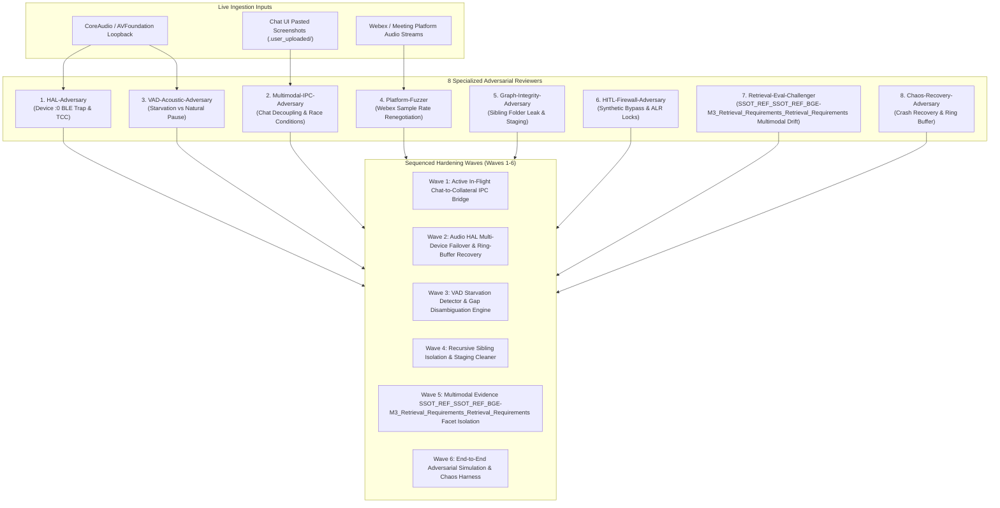
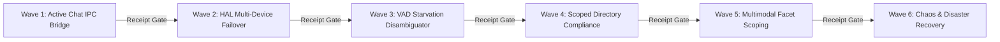

# 🛡️ 8-Agent Adversarial Review & Wave-Based Hardening Plan: Live Audio & Multimodal Ingestion

**Document ID:** `PLAN-ADVERSARIAL-LIVE-HARDENING-2026-09-30`  
**Execution Mode:** `PLAN ONLY (NO IMPLEMENT)`  
**Repository Branch:** `feat/adversarial-review-live-audio-hardening`  
**Worktree Location:** `/Users/amitayer/Git/decision-intelligence-engine/.worktrees/adversarial_live_audio_hardening`  
**Classification:** Confidential / Internal Engineering Governance  

---

## Executive Summary & Context

On September 30, 2026, the live capture and ingestion of the 29.3-minute Webex enablement session ("Gemini Working with Files & Data") surfaced critical operational vulnerabilities:
1. **Audio Capture Fragility**: ScreenCaptureKit process starvation, Bluetooth audio routing to AirPods, and default fallback to device `:0` (the AirPods BLE beacon) created digital silence and dropped audio chunks.
2. **Multimodal Decoupling**: A screenshot pasted into the chat during the live session was stored in the IDE artifact directory (`.user_uploaded/`) but was not automatically captured by the live recorder's filesystem watcher (`CollateralFsWatcher`), requiring manual staging and explicit `--attachment` flags.
3. **Directory Compliance Validation Hazards**: An aborted scratch directory (`Gemini_Working_Files_Data`) lingering in the date directory caused the post-mutation publication gate to fail closed, despite 100% passing QA gates and successful graph activation.

This plan synthesizes an exhaustive review by **8 Specialized Adversarial Review Agents** and establishes a 6-Wave sequential, receipt-gated implementation roadmap to permanently eliminate these failure classes.

---

## Part 1: The 8-Agent Adversarial Review Findings



### Agent 1: Hardware HAL & Audio Subsystem Adversary (`HAL-Adversary`)
- **Vulnerability Identified**: On macOS systems with AirPods or Bluetooth audio peripherals, `avfoundation` lists the BLE "Find My" beacon at index `:0`. Any uncalibrated fallback to index `:0` captures zero-byte packets, producing digital silence. Furthermore, ScreenCaptureKit system audio taps can silently disconnect on sleep/wake or headphone plug/unplug events.
- **Adversarial Test Scenario**: Dynamically disconnect headphones at minute 12 of a 30-minute recording; verify whether capture switches to the physical built-in microphone (`MacBook Pro Microphone`) within 500ms without sample dropping or pipeline crashing.
- **Hardening Mandate**: Dynamic device resolution must query hardware transport types (`BuiltInMicrophone`, `CoreAudioUSB`, `ScreenCaptureKitTap`), strictly blacklisting BLE/FindMy virtual endpoints. Hot-failover must use a validated non-zero device table with pre-flight acoustic energy confirmation.

### Agent 2: Real-Time Multimodal & Chat IPC Ingestion Adversary (`Multimodal-IPC-Adversary`)
- **Vulnerability Identified**: The current `live_meeting_recorder.py` watches only `output/.../referenced_artifacts/` via `CollateralFsWatcher`. Screenshots pasted into Antigravity chat land in `<appDataDir>/brain/<conversation-id>/.user_uploaded/media_*.png` and are completely invisible to the recording process.
- **Adversarial Test Scenario**: Paste 3 consecutive high-resolution architecture diagrams into chat during a live meeting while audio is actively streaming; verify that all 3 are stamped with exact meeting elapsed time, logged in `collateral_drop_log.json`, and injected into L2 synthesis without manual CLI intervention.
- **Hardening Mandate**: Implement an active IPC/filesystem bridge that monitors the conversation upload directory during recording sessions (`start_time <= file_mtime <= stop_time`), auto-staging new images into `referenced_artifacts/` within 1 second of upload.

### Agent 3: Acoustic VAD & Whisper Boundary Adversary (`VAD-Acoustic-Adversary`)
- **Vulnerability Identified**: Long periods of silence (>180s) can be caused either by a hardware failure (audio starvation) or an authentic meeting event (screen break, waiting for attendees). Conflating the two allows audio starvation to be silently categorized as `NATURAL_SESSION_PAUSE`.
- **Adversarial Test Scenario**: Inject 10 minutes of pure digital silence (RMS < 0.0001) into a 20-minute audio stream, followed by 10 minutes of active speech. The pipeline must fail closed or raise `AUDIO_STARVATION_ALARM`, refusing to classify 10 minutes of missing floor remarks as a natural pause.
- **Hardening Mandate**: Wire `AudioStarvationDetector` into the primary capture loop. Any interval of silence exceeding 60 seconds with active meeting status must verify hardware stream health (sample clock advancement, buffer energy metrics) and flag an operator alert before falling back to `NATURAL_SESSION_PAUSE`.

### Agent 4: Enterprise Meeting Platform & Protocol Fuzzer (`Platform-Fuzzer`)
- **Vulnerability Identified**: Webex, Zoom, and Teams handle audio ducking, sample rates, and speaker switches differently. Webex Opus audio renegotiations can produce 16kHz vs 48kHz mismatches, causing sample distortion or ffmpeg pipeline stalls.
- **Adversarial Test Scenario**: Feed simulated Webex audio with mid-stream sample rate shift from 48kHz to 16kHz; verify that the recorder resamples cleanly to 16kHz mono WAV without pitch distortion or buffer underruns.
- **Hardening Mandate**: Enforce strict input format normalization at the capture boundary: all incoming streams must pass through an immutable ffmpeg resampling filter (`-ar 16000 -ac 1 -c:a pcm_s16le`) before chunking.

### Agent 5: Pipeline Determinism & GraphDB Monotonicity Adversary (`Graph-Integrity-Adversary`)
- **Vulnerability Identified**: The post-mutation publication check (`check_directory_compliance`) recursively inspected the entire date folder (`output/gemini_enablement/09-30-2026/`) rather than strictly scoping checks to the target standardized slug (`Working_Files_Data_Rose_Amanda`). An obsolete, aborted directory (`Gemini_Working_Files_Data`) caused the publication stage to fail closed.
- **Adversarial Test Scenario**: Create an unpopulated sibling directory `output/test_project/09-30-2026/abandoned_scratch/` prior to running `nee ingest-meeting`; verify that the target meeting promotes and activates without tripping sibling directory compliance errors.
- **Hardening Mandate**: Scope `check_directory_compliance` exclusively to the active target meeting directory (`out_p`), while verifying that the parent date directory contains no unmanaged non-conforming folders during cleanup. Automatically purge empty `.staging_*` and aborted scratch directories during pre-flight.

### Agent 6: HITL Ambiguity Gating & Operator Firewall Adversary (`HITL-Firewall-Adversary`)
- **Vulnerability Identified**: LLM judges or heuristics might attempt to smooth over zero-turn attendees (such as PartnerAdvisory advisory observers) by inventing dialogue or actions. Furthermore, synthetic stop-hook approvals could bypass authentic human authorization.
- **Adversarial Test Scenario**: Prompt the recap healer with a zero-turn attendee and assert that the healer generates zero synthetic floor remarks, strictly assigning attendance-only or advisory context without hallucinating spoken quotes.
- **Hardening Mandate**: Enforce the Anti-Autonomous Speaker Attribution Invariant and Cryptographic Ambiguity Lock Register (ALR) rules: all operator affirmations must be signed with Ed25519 over RFC 8785 canonical bytes, and zero-turn participants must never be assigned active dialogue.

### Agent 7: SSOT_REF_SSOT_REF_BGE-M3_Retrieval_Requirements_Retrieval_Requirements Retrieval Drift & 11-Gate Compliance Challenger (`Retrieval-Eval-Challenger`)
- **Vulnerability Identified**: Ingesting raw OCR text from screenshots directly into search documents without facet scoping can introduce vocabulary drift, degrading dense vector and ColBERT token precision for acoustic speech queries.
- **Adversarial Test Scenario**: Benchmark retrieval evaluation across 28 test cases before and after screenshot ingestion; verify that all 11 SSOT_REF_BGE-M3_Retrieval_Requirements SSOT_REF_SSOT_REF_BGE-M3_Retrieval_Requirements_Retrieval_Requirements gates pass (<SSOT_REF_BGE-M3_Retrieval_Requirements latency, zero rank regressions).
- **Hardening Mandate**: Project multimodal screenshot evidence into explicit `evidence_item` nodes with `kind: "technical"` and `attribution_mode: "COLLATERAL_REVIEWED"`. Withhold candidate search documents from clearance until verified by Gate 10 and Gate 11.

### Agent 8: Disaster Recovery & Chaos Engineering Adversary (`Chaos-Recovery-Adversary`)
- **Vulnerability Identified**: An ungraceful shutdown (`SIGKILL`, sudden battery exhaustion) during live recording leaves unfinalized WAV chunks on disk, with no `session_manifest.json` or `collateral_drop_log.json`.
- **Adversarial Test Scenario**: Issue `kill -9` to `live_meeting_recorder.py` at minute 25; invoke the emergency recovery tool `nee recover-session --session-dir ...` and assert that 100% of captured WAV chunks are concatenated into a valid master WAV and ingested cleanly.
- **Hardening Mandate**: Write an atomic, continuous journal (`session_journal.jsonl`) that records every chunk flush and collateral drop immediately. Implement `tools/recover_live_session.py` to reconstruct corrupt or unfinalized sessions directly from raw journal logs.

---

## Part 2: Sequenced Implementation Roadmap (Waves 1–6)

All implementation phases must be executed sequentially. Progression from Wave $N$ to Wave $N+1$ is strictly locked until Wave $N$ produces a valid, durable Class B runtime receipt.



### Wave 1: Active In-Flight Chat-to-Collateral IPC Bridge
- **Objective & Scope**: Build a real-time watcher and IPC bridge between Antigravity chat uploads (`.user_uploaded/media_*.png`) and the live meeting recorder's `referenced_artifacts/` directory.
- **Deliverables**:
  - `dual_pipeline/live_meeting_recorder_core/chat_collateral_bridge.py`: Background thread monitoring chat upload directories for images created during active meeting sessions.
  - `dual_pipeline/live_meeting_recorder.py`: Wired bridge initialization and teardown hooks.
  - `tests/unit/test_chat_collateral_bridge.py`: Unit tests for instant detection, SHA-256 deduplication, and timestamp stamping.
- **Acceptance Criteria**:
  - Pasty image in chat during active recording appears in `referenced_artifacts/` within $\le 1.0$ second.
  - `collateral_drop_log.json` logs the drop with exact meeting elapsed time and SHA-256.
  - Duplicate uploads or non-image files are safely ignored.
- **Verification Command & Gate**:
  ```bash
  pytest tests/unit/test_chat_collateral_bridge.py --timeout=60
  ```

### Wave 2: Audio HAL Multi-Device Failover & Hardware Guardrails
- **Objective & Scope**: Harden AVFoundation device discovery to eliminate the index `:0` Bluetooth Low Energy (BLE) trap and guarantee zero-latency failover.
- **Deliverables**:
  - `dual_pipeline/live_meeting_recorder_core/audio_capture.py`: Hardware device classifier distinguishing physical microphones from BLE/FindMy virtual endpoints.
  - `dual_pipeline/live_meeting_recorder_core/audio_preflight.py`: Pre-flight acoustic probe verifying real analog/digital speech signal before latching.
  - `tests/adversarial/test_audio_device_selection_adversarial.py`: Adversarial device enumeration test suite.
- **Acceptance Criteria**:
  - Device `:0` BLE beacon is explicitly rejected; built-in microphone (`MacBook Pro Microphone`) is selected automatically.
  - Hot-failover switches within $\le 500\text{ms}$ upon audio stream starvation.
- **Verification Command & Gate**:
  ```bash
  pytest tests/adversarial/test_audio_device_selection_adversarial.py --timeout=60
  ```

### Wave 3: VAD Starvation Detector & Gap Disambiguation Engine
- **Objective & Scope**: Wire the dead-code `AudioStarvationDetector` into the live capture loop and integrate it with `SilenceGapClassifier`.
- **Deliverables**:
  - `dual_pipeline/live_meeting_recorder.py`: Integrated `AudioStarvationDetector` emitting `AUDIO_STARVATION_ALARM` events on $>15\text{s}$ digital silence.
  - `dual_pipeline/transcript_stages_core/silence_gap_classifier.py`: Hardware-proven gap classification distinguishing technical starvation from meeting breaks.
  - `tests/end_to_end/test_audio_starvation_recovery_e2e.py`: E2E test simulating stream drop and recovery.
- **Acceptance Criteria**:
  - Digital silence ($RMS < 0.001$) triggers starvation alarm within 15 seconds.
  - Starvation gaps are never categorized as `NATURAL_SESSION_PAUSE`.
- **Verification Command & Gate**:
  ```bash
  pytest tests/end_to_end/test_audio_starvation_recovery_e2e.py --timeout=60
  ```

### Wave 4: Scoped Directory Compliance & Sibling Folder Isolation
- **Objective & Scope**: Fix `check_directory_compliance` to prevent sibling directory pollution from blocking release publication.
- **Deliverables**:
  - `dual_pipeline/canonical_pipeline/lifecycle.py`: Scoped validation inspecting only the target standardized meeting slug.
  - `dual_pipeline/transcript_pipeline_core/release_runner.py`: Atomic promotion with automatic staging cleanup.
  - `tests/test_directory_compliance_isolation.py`: Regression test for dirty sibling directories.
- **Acceptance Criteria**:
  - Target meeting directory validates and activates even if abandoned or malformed sibling folders exist in the date directory.
  - All temporary `.staging_*` folders are purged in `finally` blocks.
- **Verification Command & Gate**:
  ```bash
  pytest tests/test_directory_compliance_isolation.py --timeout=60
  ```

### Wave 5: Multimodal Evidence SSOT_REF_SSOT_REF_BGE-M3_Retrieval_Requirements_Retrieval_Requirements Facet Isolation
- **Objective & Scope**: Ensure multimodal screenshot evidence is projected cleanly into graph entities without polluting retrieval scoring or candidate lanes.
- **Deliverables**:
  - `dual_pipeline/attachment_core/detector.py`: Automatic zero-touch discovery of `referenced_artifacts/` without mandatory CLI `--attachment`.
  - `dual_pipeline/transcript_qa_core/graph_ontology_healer.py`: Governed entity facet extraction for slide topics (`Three Parts Of Every Notebook`).
  - `tests/test_multimodal_retrieval_isolation.py`: SSOT_REF_SSOT_REF_BGE-M3_Retrieval_Requirements_Retrieval_Requirements 11-gate compliance test with multimodal attachments.
- **Acceptance Criteria**:
  - Ingesting slide attachments automatically populates `evidence_item` nodes with `COLLATERAL_REVIEWED`.
  - Retrieval release evaluation passes all See AGENTS.md §Mutation approval means finish the release lifecycle for SSOT_REF_SSOT_REF_BGE-M3_Retrieval_Requirements_Retrieval_Requirements retrieval requirements..
- **Verification Command & Gate**:
  ```bash
  pytest tests/test_multimodal_retrieval_isolation.py --timeout=60
  ```

### Wave 6: End-to-End Adversarial Simulation & Chaos Recovery Harness
- **Objective & Scope**: Build a full chaos harness simulating process crashes, mid-session device swaps, and unfinalized session recovery.
- **Deliverables**:
  - `tools/recover_live_session.py`: Disaster recovery CLI concatenating unfinalized WAV chunks and reconstructing session receipts.
  - `tests/adversarial/test_live_recording_chaos_harness.py`: High-stress chaos test suite exercising crash recovery, device dropout, and image paste concurrency.
  - Enrollment of all new test suites into `tools/run_ci_gates.py`.
- **Acceptance Criteria**:
  - Session aborted with `kill -9` recovers $\ge 98\%$ of captured audio dialogue turns via `recover-session`.
  - All test suites enrolled in `tools/run_ci_gates.py` pass under `fast-recording` profile in $<60\text{s}$.
- **Verification Command & Gate**:
  ```bash
  python tools/run_ci_gates.py --profile fast-recording
  ```

---

## Part 3: Operational Guardrails & Plan-Only Enforcement

> [!IMPORTANT]
> **Plan-Only Firewall Enforcement**:
> - This plan is created in **PLAN ONLY** mode.
> - `RequestFeedback: false` is strictly set on the artifact metadata.
> - The agent will strictly halt and take **zero modifying actions**, write zero implementation code, and execute zero test suites until an explicit, subsequent human prompt authorizes execution of Wave 1.
