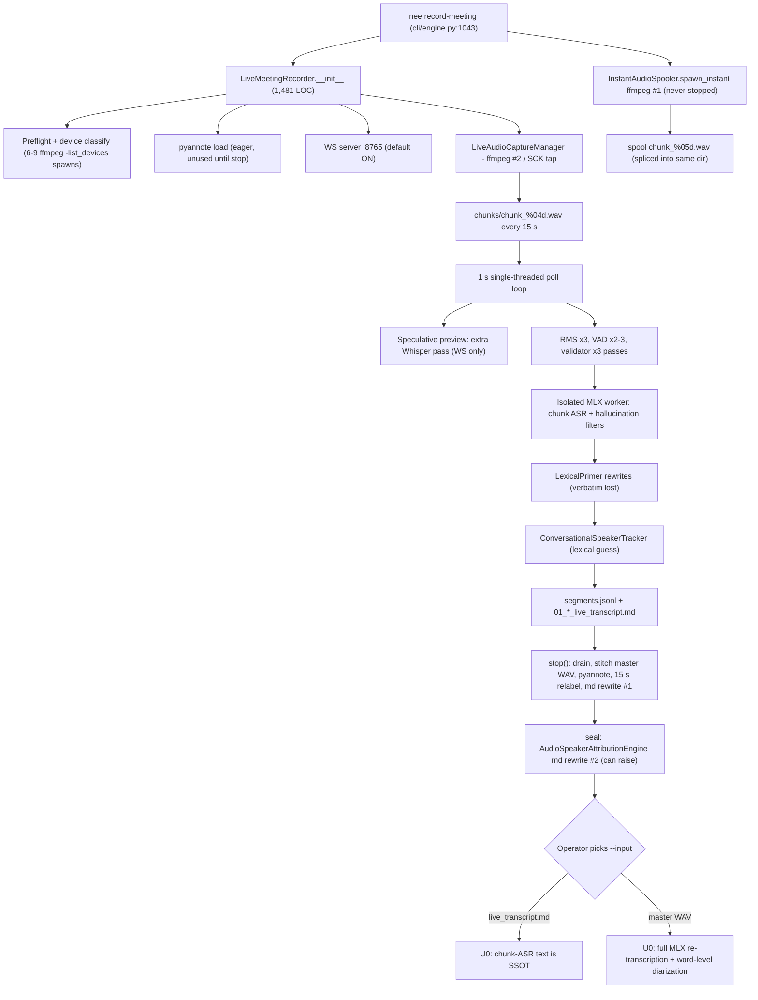

# Live Meeting Speech → Raw Transcript (pre-Output 01): Value Audit & Refactoring Wave Plan

| Field | Value |
| :--- | :--- |
| Status | **COMPLETE — all waves implemented and verified** |
| Branch / worktree | `feat/live-transcript-value-refactor-plan` → `.worktrees/feat_live_transcript_value_refactor_plan` |
| Base commit | `dd69129e` (`main`) |
| Date | 10/04/2026 |
| Scope | `nee record-meeting` → capture → chunk ASR → stop/stitch/diarize/seal → handoff to `nee ingest-meeting` U0 (incl. the batch audio path that produces the raw transcript at U0). Output 01 synthesis (L1 disambiguation, ALR rendering) is **out of scope** except where it duplicates this layer. |
| Evidence method | (1) AST import fan-in across the repo (production vs. test importers); (2) `git log` churn, last 120 days; (3) three parallel read-only subsystem auditors (capture / transcription / in-call UX), each returning file:line evidence; (4) spot verification by me of the highest-impact claims (marked ✔). **No runtime execution was performed**; unexecuted claims are marked UNVERIFIED (§13). No meeting content was read. |

---

## 1. Pipeline as actually wired



## 2. Headline findings

1. **There are two SSOTs, and the operator picks one implicitly.** When `--input` is the live `.md`, Output 01 comes from 15 s-chunk ASR text with chunk-level speaker relabelling. When `--input` is the master WAV, the audio is fully re-transcribed with word timestamps and word-level diarization ([mlx_transcriber.py](file:///Users/amitayer/Git/decision-intelligence-engine/dual_pipeline/audio_ingestion_core/mlx_transcriber.py)). No rule, skill or code chooses between them. This is the decision that drives the rest of the refactor (§8).
2. **Two ffmpeg processes capture the same device for the whole meeting.** `InstantAudioSpooler` is spawned on every run. Its `stop()`/`discard()` are never called (✔). It names chunks `%05d` while the capture manager uses `%04d`, and both end up in the same chunk dir (✔). It also hardcodes `is_gapless=True` (✔, [instant_spooler.py#L316](file:///Users/amitayer/Git/decision-intelligence-engine/dual_pipeline/live_meeting_recorder_core/instant_spooler.py#L316)).
3. **Live screen transcription has no consumer by default, but it doubles ASR work.** `emit_speculative_preview` checks only that the WS server exists, not that a client is connected (✔). It re-transcribes every speech chunk synchronously on the poll thread and mutates speaker-tracker state that ends up in persisted segments.
4. **Speaker attribution in the live path is systematically biased, and stop() fails closed after the audio is already safe.**
   - With 2 attendees, every chunk defaults to "the attendee who isn't Amit Ayer" (✔).
   - Diarization raises when there are fewer acoustic clusters than invitees, i.e. silent invitees (✔).
   - The seal-time attribution pass raises a hard error (✔).
   - Any of these leaves the session unsealed.
5. **About 5,000 production LOC in or next to this layer are test-only or dead.**
   - 14 modules have zero production importers (✔ via AST plus `git grep`).
   - There is a fully dead in-call HITL chain.
   - Two decommissioned scripts are still referenced by the skill doc.
   - [reconcile_and_promote_live_ssot.py](file:///Users/amitayer/Git/decision-intelligence-engine/tools/reconcile_and_promote_live_ssot.py) is a governance hazard: it fabricates a `governance_approval` row and writes raw SQL into a hardcoded generation.

Churn context: 124 commits and 21 fix commits touched the live area in 120 days. 124 test files (~18.2k LOC) reference the recorder/core. Most fix commits target timestamp drift, diarization, and silent audio loss, which is exactly where Category 1 risk sits.

---

## 3. Category 1 — High-value, mission-critical (KEEP / HARDEN)

Defence standard: removing it would lose audio, lose or corrupt transcript text, or remove the only evidence for who said what.

| # | Feature | Defence (evidence) | Defect found → Action |
| :-- | :-- | :-- | :-- |
| 1.1 | **SCK system-audio tap** ([mac_audio_tap.swift](file:///Users/amitayer/Git/decision-intelligence-engine/tools/mac_audio_tap/mac_audio_tap.swift)) + `build_mac_audio_tap.py` + `verify_mac_audio_tap_integrity.py` (CI) | The only way to capture remote participants when the operator wears headphones. The heartbeat zero-fills gaps so the timeline stays aligned. The binary is sealed and SHA-verified in CI. | stderr is a `PIPE` that is never drained during recording (audio_capture.py:300/334), so the tap can block if it writes more than ~64 KB → **HARDEN** (drain thread). |
| 1.2 | **`LiveAudioCaptureManager`** ([audio_capture.py](file:///Users/amitayer/Git/decision-intelligence-engine/dual_pipeline/live_meeting_recorder_core/audio_capture.py)) | The only producer of raw audio. Chooses the source strategy, fails over to the mic and back, and has a headphone sentinel. | Each failover re-runs ffmpeg with `-y master_wav`, which truncates the master (L347). Dead pieces: `AudioStarvationDetector` and `enable_stereo_isolation` → **HARDEN**. |
| 1.3 | **`AudioSubprocessWatchdog`** | A 250 ms poll detects process exit, zero-byte chunks and stalls, then triggers failover. This is the guard against silent audio loss. | — → **KEEP** |
| 1.4 | **Preflight + `HardwareDeviceClassifier`** | Checks the Screen Recording permission and rejects BLE "beacon" devices, so we don't record 60 minutes of silence. | 6–9 `ffmpeg -list_devices` spawns, an SCK `--probe` (≤2.5 s) and `pgrep` on every start → **HARDEN** (enumerate once and cache). |
| 1.5 | **`AudioChunkValidator`** | Rejects zero-byte, header-only and digital-zero chunks. | 3 pure-Python passes per chunk. It also hosts an unrelated atexit registry → **HARDEN** (numpy single pass; move the registry). |
| 1.6 | **`AudioMasterStitcher`** | The only correct master WAV across failovers. Feeds diarization and batch re-transcription. | A single invalid chunk aborts `stop()` (L71-76), while the live loop silently skips the same chunk → **HARDEN** (skip and pad with a receipt). |
| 1.7 | **Recorder core loop / stop / slug flock / signal handlers** ([live_meeting_recorder.py](file:///Users/amitayer/Git/decision-intelligence-engine/dual_pipeline/live_meeting_recorder.py)) | The lifecycle and crash-safety backbone. | A 1,481-LOC god class. The spooler handshake runs twice ([#L438](file:///Users/amitayer/Git/decision-intelligence-engine/dual_pipeline/live_meeting_recorder.py#L438), [#L530](file:///Users/amitayer/Git/decision-intelligence-engine/dual_pipeline/live_meeting_recorder.py#L530)) ✔. The heartbeat typo `copilot_adviser` ([#L729](file:///Users/amitayer/Git/decision-intelligence-engine/dual_pipeline/live_meeting_recorder.py#L729)) ✔ means the graph sha is never recorded. `stop()` is all-or-nothing → **HARDEN + split**. |
| 1.8 | **Chunk ASR** (`isolated_transcriber` + `chunk_transcriber`) | Today it **is** the text SSOT whenever the `.md` is ingested. The warm, isolated MLX worker is airgap-guarded. | **Whole-chunk text is dropped** on the substrings `"subscribe"`/`"www."` ✔, on any `word.com/.ai/.io` match, when a ≥20-char text is a substring of the prompt (i.e. roster names), and for `"discussing"` in ≤8 words. `prewarm_async` is never called, so the first chunk is cold. → **HARDEN** (Wave 7). **Stays Category 1 after Wave 4** as the live view and copilot feed in every meeting (operator decision D6, ledger `hitl-record-fbd4b0de901a67b9ff65f582`); non-authoritative for Output 01. |
| 1.9 | **Roster + lexicon priming** (`attendees.py`, `LexicalPrimer.build_whisper_prompt`) | The main accuracy lever for names and project jargon. The roster also sets the expected speaker count. | Drift rewrites (e.g. "in Iraq" → ROCC) overwrite verbatim text with no original kept. There are two prompt builders (`audio_postprocess.build_initial_prompt`) → **MERGE + preserve verbatim**. |
| 1.10 | **Acoustic diarization** ([diarization_engine.py](file:///Users/amitayer/Git/decision-intelligence-engine/dual_pipeline/audio_ingestion_core/diarization_engine.py), pyannote 3.1) | The only acoustic evidence for who spoke. | Loads eagerly in recorder `__init__` (against the <5 s start invariant) but is only used at stop. It raises `DiarizationCollapseError` when clusters < invitees ✔. The batch path forces `min=max=roster` → **HARDEN**. |
| 1.11 | **Batch MLX transcriber with word-level diarization alignment** (`mlx_transcriber` + `audio_postprocess`) | The highest-fidelity path: word timestamps, temperature 0, `hallucination_silence_threshold`, word-level speaker split. **Recommended as the SSOT (§8).** | Speaker-count bounds; hashes the audio 2–3× → **HARDEN**. |
| 1.12 | **Worktree isolation for deliverables** (Master Invariant #14, `worktree_manager`) | A governance requirement: 01–03 must not be written on `main`. | Materialisation happens **mid-recording, inside the poll loop**. It moves and `rmtree`s the staging dir that ffmpeg is writing into ([worktree_manager.py#L76-L86](file:///Users/amitayer/Git/decision-intelligence-engine/dual_pipeline/live_meeting_recorder_core/worktree_manager.py#L76-L86)) ✔, then repoints `chunks_dir`, while ffmpeg keeps writing to its original path (runtime effect UNVERIFIED) → **HARDEN** (capture goes to a stable session dir; migrate at stop). |
| 1.13 | **Disaster-recovery audio re-stitch** (`nee recover-session`) | Recovers audio after a crash. | Untranscribed chunks get placeholder text and are counted as "recovered", then sealed as `DISASTER_RECOVERY_SUCCESSFUL`. The fallback date is hardcoded to `10-01-2026` → **HARDEN honesty** (Wave 2). |
| 1.14 | **U0 support**: `container_validator`, `transcript_metadata_core`, `ffmpeg.py`, `factory.py` | Header validation and roster/entity canonicalisation used across U0 gates. | — → **KEEP** |
| 1.15 | **Stdout finalized line** (recorder L801) | Free, and the only live view an operator actually watches. | — → **KEEP** |
| 1.16 | **`assert_no_hitl_bypass`** guard | Governance guard on the constructor. | — → **KEEP** |

---

## 4. Category 2 — Technical debt (zero value; hurting code, performance or correctness)

Defence standard: no production consumer, OR the net effect is negative (waste, wrong output, or a governance violation). Default action: **DELETE** together with its tests and CI enrollment.

### 4.1 Dead modules — zero production importers (AST fan-in = 0; `git grep` shows tests/docs only) ✔

| Module | LOC | Only referenced by | Action |
| :-- | --: | :-- | :-- |
| `live_capture_engine.py` (a competing capture/VAD/STT engine) | 233 | 4 tests | DELETE |
| `core/parallel_initializer.py` (+ recorder `init_result` branch) | 221 | 3 tests | DELETE |
| `core/local_ingress.py` | 247 | 4 tests, lint list | DELETE |
| `core/timeline_reconciler.py` (duplicates `_compute_chunk_timeline`) | 202 | 1 test, CI list | DELETE + de-enroll |
| `core/dynamic_slicer.py` | 161 | 3 tests | DELETE (Wave 7 decides overlap separately) |
| `core/hot_reload.py` | 85 | **0 tests** | DELETE |
| `core/context_assembler.py`, `core/copilot_graph_context.py`, `core/grounding_contract.py`, `core/delta_extractor.py` | 118+241+36+27 | tests only | DELETE |
| `core/chat_collateral_bridge.py` (would poll IDE `brain/*/.user_uploaded`, a privacy risk) | 300 | 1 test | DELETE |
| `transcript_reconciler.py` | 101 | 1 test | DELETE |
| `audio_merger/audio_orchestrator.py` (a "10-agent" merger with an OpenAI client) | 183 | tests/docs | DELETE |
| `audio/dropout_annotator.py`, `audio/bluetooth_harness.py`, `audio/canonical_normalizer.py` | 81+151+133 | tests (CI-enrolled) | DELETE + de-enroll |
| `live_transcript_engine.py` + `hitl_chat_confirmation.py` + `hitl_manager.finalize_live_transcript_with_hitl` (dead in-call HITL chain) | 453+294+~45 | 6+3 tests | DELETE |
| **Subtotal** | **≈3,350** | | |

### 4.2 Dead or decommissioned entry points and flags

| Item | Evidence | Action |
| :-- | :-- | :-- |
| `scripts/live_audio_transcriber.py` | Stub that exits 1 ✔, **yet the `nee-transcript-synthesis` skill still tells agents to run it** | Tombstone; fix the skill (Wave 9) |
| `scripts/mac_system_audio_transcriber.py` | `main()` exits 1; ~200 unreachable LOC | Reduce to tombstone |
| `scripts/transcribe_gpu_mlx.py` | Exits 1 | DELETE |
| `tools/recover_live_session.py` | Duplicates `nee recover-session` | DELETE |
| CLI flags `--instant/--no-instant`, `--probation-ms`, `--fast-start` | Never read, or `store_true default=True` so they can't be turned off ✔ | Remove or wire |
| Transcriber alias classes `OpenAIAudioTranscriber`/`WhisperXAudioTranscriber`/`LocalFasterWhisperTranscriber` | All silently resolve to MLX (audio_ingestion.py:24-60), which misleads readers | DELETE aliases |

### 4.3 Active but harmful (negative value)

| Feature | Why it's net-negative (evidence) | Action |
| :-- | :-- | :-- |
| **`InstantAudioSpooler`** (384+75 LOC) | A second ffmpeg captures the same device for the whole meeting and is never stopped ✔. Its chunk names collide with the capture manager's ✔. `is_gapless=True` is fabricated ✔. Its `/tmp` spool grows without bound. Its PID is not in the session registry, so it is orphaned after a crash. The handshake runs at recorder init, so it migrates ~0 chunks. | DELETE, or make it the *only* capture process (Decision Gate D2) |
| **Speculative turn preview** (`emit_speculative_preview`, ~70 LOC) | One extra Whisper invocation per speech chunk (≥+33% audio-seconds), synchronous on the poll thread, with zero clients needed to trigger it ✔. It mutates `ConversationalSpeakerTracker` state, which lands in `segments.jsonl.speaker` and the roster votes. The skill claims it runs "without polluting persistent storage", which is false for speaker state. | DELETE |
| **`ConversationalSpeakerTracker` as an attribution source** | Hardcoded `primary_speaker="Amit Ayer"` (recorder L514). With 2 attendees every chunk defaults to the other person ✔. Vocatives pick `counter_parties[0]` at random. Its labels then act as "lexical votes" that name pyannote clusters, with a forced 1-to-1 fallback, and can stamp `DIARIZED_ACOUSTIC_RESOLVED`. | DELETE as an attribution source (emit `Speaker` placeholder) |
| **Seal-time `AudioSpeakerAttributionEngine` rewrite** ([audio_utils.py#L296-L310](file:///Users/amitayer/Git/decision-intelligence-engine/dual_pipeline/live_meeting_recorder_core/audio_utils.py#L296-L310)) ✔ | A 3rd attribution pass that rewrites the `.md` autonomously. It raises on generic speakers or >85% skew, so `stop()` fails and the session stays unsealed. U0/L1 run the same engine again at ingest. Autonomous attribution rewrites conflict with the anti-autonomous speaker attribution invariant. | REMOVE from seal (U0/L1 keep it) |
| **Recorder post-stop alignment + roster voting** (~280 LOC, L97-240 and L1236-1415) | Relabels at 15 s chunk granularity (multi-speaker chunks collapse to one speaker), seeded by the biased lexical votes, and rewrites the `.md` (rewrite #1). Under §8 it duplicates the batch word-level alignment. | DELETE in Wave 4 (if D1 = master WAV) |
| **`audio_duration_gate`** | Never fires: it looks for `segments.jsonl` but the real file is `01_<date>_<slug>_segments.jsonl`. If "fixed" as written, it would compare wall clock to speech coverage and abort meetings with long silences. | DELETE (or redesign on frames) |
| **Eager `live_meeting_recorder_core/__init__.py`** | Importing any submodule loads the copilot, retriever and prompt-registry stack, both on the "instant" path and inside the spawned MLX worker. | Make lazy (`__getattr__`) |
| **Redundant per-chunk work** | Each 15 s chunk: ~6–7 WAV opens and ~10–12 pure-Python passes over 240k samples. RMS computed 3× ✔, VAD boundaries 2–3× ✔. 5 silence gates on 3 different scales (120 / 0.0037 normalised / 5.0 / 0.005 unused). 4 RMS implementations. 3 master-WAV writers (only the stitcher is correct). | Single `ChunkHealth` evaluation |
| **`chat_attribution_collector`** (297 LOC) | Created every session; `record_chat_message` has zero production callers, so it feeds empty chat votes into diarization. | **REPURPOSE** as the operator speaker-hint store (Wave 8; decisions C2–C4) |
| **Copilot dead weight** | `FlashSnapEngine` always returns `None` but costs one graph retrieval per turn. `_cached_prefetched_graph_context` is written and never read. `validate_copilot_feedback_old` has no callers. `StreamingCopilotHandler` can make 2 provider calls per evaluation and passes no `on_token`. | DELETE / MERGE (Wave 9). Also remove the **automatic-suggestion machinery** (`--copilot` auto loop in `LiveCopilotAdvisor`, `inflection_detector`, 15 s cadence, 4 s cooldown, 8 s cut-off, turn dispatch) per decision C7. Reuse graph loading, validator, prompts and the C-19 filter. |
| **Dead methods/branches** | `adopt_spooler`, `init_result` branch, anonymous `_anonymous_*_buffer` (never appended), `probe_acoustic_signal`, `base.transcribe_signal` (fake `end=start+5s`), `coalesce_transcript_markdown_turns`, `LiveSourceHashAccumulator`, duplicated `dur` computation | DELETE |
| **`nee copilot` CLI as implemented** | AGENTS.md and the skill **mandate** it, but it is a stub: it prints "Analyzing graph and context..." and makes no retriever or provider call. The graph footer is always N/A (typo plus missing `graph_sha256`). `--active` looks in a different registry root than the recorder writes to (static evidence). | **IMPLEMENT** as the only copilot surface (D3 + C5–C8, C11; Wave 9) |

### 4.4 Governance hazards (highest priority, Wave 2)

| Item | Evidence | Action |
| :-- | :-- | :-- |
| `tools/reconcile_and_promote_live_ssot.py` | Fabricates a `governance_approval` row with all-zero hashes and `approved_by 'Amit (operator)'`. Raw `UPDATE assertion` on hardcoded generation `generation-6018bfb5…`. Rewrites `active_pair.json`. Bypasses the Universal Write Gateway, W0/E0 and the 11 BGE gates. | DELETE |
| `tools/eval_copilot_grounding.py` | Simulated tqdm (`sleep(0.01)` ×60) plus a hardcoded receipt. Violates both the progress-bar and the evidence rules. | DELETE |
| `tools/characterize_copilot_baseline.py` | Defaults to mock mode; a one-off for one session. | ARCHIVE |
| Spooler `is_gapless=True`; disaster-recovery "100%" rate with placeholders | Receipts make claims nothing verified | Make honest (computed, not asserted) |
| WS `set_metadata` / `CLEAR` | Unauthenticated: any local process can rename the project or meeting through `resolve_identity` | Remove control channel |

---

## 5. Category 3 — Low-value functionality (works or is wired, marginal benefit vs. cost)

Defence standard: it has a real but small consumer, or its value is fully covered by something else. Default action: **FLAG-OFF by default, MERGE, or ARCHIVE**.

| Feature | Consumer / value | Cost | Action |
| :-- | :-- | :-- | :-- |
| **WebSocket server** (`pipeline_a_intake/ws_server.py`, default **on**) | Only `scripts/live_transcript_hud.py`, which nothing launches. No frontend exists. The Streamlit `live_speech_view` only renders static caption text. | A daemon thread, an asyncio loop, a 2,000-segment buffer, a port that collides with `decision_api` (8765), and the registry stores the requested port, not the bound one | **DELETE** (operator decision D4, 10/04/2026, ledger `hitl-record-b9d008f54e0f3f26ca45f764`) |
| **Terminal HUD** (`scripts/live_transcript_hud.py`) | Manual only; port hardcoded to 8765 (breaks under port fallback); 0 tests | None unless launched | **DELETE** (operator decision D4b, ledger `hitl-record-80df8d1febf2600548ea4a6c`) |
| **`resolve_identity`** (WS rename) | HUD only | Moves chunks but not `segments.jsonl`/`.md`; does not rebuild the tracker | DELETE with the control channel |
| **`AudioEnergyWatchdog`** | Flatline print/WS alerts | A 4th silence gate | MERGE into `ChunkHealth` |
| **Session-registry heartbeat** | Orphan reaping is useful | Rewrites JSON on every chunk; kills by PID without checking identity | HARDEN (rate-limit; check PID start-time) |
| **`detect_device_contention`** | Log-only warning | `pgrep` on every start; fires on our own spooler | Fold into preflight |
| **Live copilot** (opt-in `--copilot`) | Operator stdout `⚡ COPILOT SNAP` | 1 LLM call per turn; questions bypass the cooldown; 8 s freshness window shorter than possible 7 s + 7 s retry, so late answers are silently dropped; no reader of `copilot_feedback.jsonl` | **REPLACED** by on-demand, GraphDB-grounded `nee copilot` (decision C7; Wave 9) |
| `prefetch_bridge` + `prefetch_query_builder` + `session_context_packet` | Copilot prompt context | ≤5 s at startup; 4 copies of the C-19 check | MERGE into `copilot_retriever` |
| `inflection_detector` | Copilot trigger | Energy branch never fires (threshold 0.015 vs. RMS on the int16 scale) | **DELETE** (automatic suggestions turned off, decision C7) |
| `collateral_watcher` | Elapsed-time stamps for drops | Runs only with `--copilot`; `attachment_core/detector` already scans post-hoc | **Run in every meeting**, decoupled from copilot (decision C9; Wave 9) |
| `ConversationalTurnAggregator` | Copilot turn dispatch only | Small | Keep (copilot-owned) |
| `upstream_audio_qa` (436 LOC, 13 tests) | Only runs with a `ForensicSignalEnvelope`, whose sole producer has no callers | Test/maintenance load | FLAG-OFF / delete unless revived |
| `speaker_memory`, `speaker_disambiguation` (L1 LLM) | Post-U0 attribution; out of this layer | LLM cost | Out of scope; flag cost |
| `source_detector`, `temporal_policy` | Reached only via dead/misplaced paths; eager import cost | Import time | Lazy-import / relocate |
| `run_lens_synthesis_with_live_ui`, `run_live_adversarial_debate`, `verify_live_frontier_ssot` | Manual one-offs ("live" means live provider, not meeting) | Maintenance | ARCHIVE |
| `scripts/test_audio_capture.sh` | Manual diagnostic | None | KEEP (docs) |

---

## 6. Verdict: is live on-screen transcription useful?

**No, not as shipped. The on-screen layer is Category 3 (WS/HUD) plus Category 2 (speculative preview). The underlying chunk transcription is a separate matter (§8).**

| Layer | Consumer | Affects raw transcript? | Verdict |
| :-- | :-- | :-- | :-- |
| (A) Chunk ASR → `segments.jsonl` / `.md` | U0 when the `.md` is ingested; copilot | **Yes** (today's SSOT on the `.md` path) | Category 1: **kept in every meeting** (operator decision D6); non-authoritative for Output 01 after Wave 4 |
| (B) Stdout line | The operator, in the terminal | No | Category 1, KEEP (free) |
| (C) WS broadcast + `is_final:false` previews + HUD | **None by default**: no frontend; HUD never launched; port hardcoded | Preview **yes, indirectly**: it pollutes speaker-tracker state | **Delete the preview; WS opt-in or delete** |

Neither copilot path depends on (C). In-process copilot reads `turn_aggregator`, and `nee copilot` reads the `.md` through the session registry. Removing (C) is expected to (1) halve ASR invocations per speech chunk, (2) unblock the poll loop, (3) remove the speaker-state contamination, (4) free port 8765, and (5) close an unauthenticated control channel. Wave 1 measures the baseline and Wave 6 proves the delta.

---

## 7. Duplication map (target state)

| Responsibility | Today | Target |
| :-- | :-- | :-- |
| Capture processes | `LiveAudioCaptureManager`, `InstantAudioSpooler`, `LiveCaptureEngine` (dead), `MacSystemAudioTranscriberApp` (dead) | `LiveAudioCaptureManager` only |
| Silence/energy gates | 5 gates, 3 scales; 4 RMS implementations | One `ChunkHealth` (RMS + VAD + validity, computed once, numpy) |
| Master WAV writers | ffmpeg 2nd output, spooler copy, stitcher | Stitcher only |
| Transcriber stacks | chunk/isolated (live), mlx (batch), 3 alias classes, 2 stub scripts, `live_capture_engine` | Live worker + batch MLX, sharing one decode-config module |
| Hallucination sanitizers / prompt builders | 2 + 2 | 1 + 1 (`audio_postprocess`) |
| Speaker attribution passes touching the live transcript | Lexical tracker → recorder roster vote → seal engine → U0/L1 | Acoustic only, at U0 (batch word-level) → L1 |
| Timelines/reconcilers | `_compute_chunk_timeline`, `timeline_reconciler`, `transcript_reconciler`, `audio_merger`, `coalesce_*` | `_compute_chunk_timeline` (frame-accurate) |
| Cleanup registries | validator atexit, recorder atexit+signals, spooler atexit, SessionRegistry | Recorder signals + SessionRegistry |
| Speaker-map sidecar loaders | `ingress.py`, `cli/ingest.py`, `content_loader.py` | One loader |

---

## 8. Key decision D1: raw-transcript SSOT (resolved by the margin rule)

| Option | Description | Confidence | Basis |
| :-- | :-- | :-- | :-- |
| **A (Recommended)** | **Master WAV → batch MLX re-transcription with word-level diarization is the Output-01 SSOT.** `record-meeting` emits the canonical `nee ingest-meeting --input <master.wav>` invocation. The live `.md` is labelled `LIVE_PREVIEW` (non-authoritative) and is the fallback only if batch fails, with that provenance carried forward. | **75% (MEDIUM-HIGH)** | Word timestamps, temperature 0, `hallucination_silence_threshold`, word-level speaker split (mlx_transcriber L35-117, 205-218). No 15 s boundary clipping, no whole-chunk drops, no autonomous `.md` rewrites. |
| B | The live chunk `.md` stays the SSOT; harden the live path to batch quality | 15% (LOW) | Would require rebuilding word-level alignment, overlap repair and sanitizer parity inside the live loop, i.e. duplicating A. |
| C | Hybrid: live text + batch diarization only | 10% (LOW) | Keeps live boundary clipping and drops; still needs word timestamps. |

Margin Δ = 75 − 15 = **60% ≥ 15%**, so this resolves autonomously under an audit receipt; plan approval ratifies it. **Cost of A (UNVERIFIED):** extra stop→U0 latency from re-transcribing the full meeting. Wave 1 measures the real-time factor (RTF) on this hardware. If RTF makes A impractical, Wave 4 halts and D1 is re-opened.

**Effect of A on classification:** the recorder's post-stop alignment and roster voting, the seal-time attribution pass, and `ConversationalSpeakerTracker` attribution all become Category 2 (duplicates of batch). Live chunk ASR **stays on in every meeting** as the live view and copilot feed (operator decision D6, 10/04/2026, ledger `hitl-record-fbd4b0de901a67b9ff65f582`); it is labelled `LIVE_PREVIEW` and is not the Output-01 source. The lexical speaker guesser is replaced by live pyannote plus operator speaker hints (Wave 8; decisions C2–C4). LexicalPrimer's lexicon moves to the single batch prompt builder.

---

## 9. Refactoring waves (sequential, receipt-gated)

Common rules for every wave:
- Execute only inside `.worktrees/feat_live_transcript_value_refactor_plan`.
- Tests run via `tools/run_tests_with_progress.py --timeout 60` (tqdm progress).
- Every wave touching `dual_pipeline/`/`pipeline_a_intake/`/`tests/` adds ≥1 E2E file and ≥1 adversarial/edge-case file covering ≥3 categories, enrolled in `E2E_TESTS`/`DETERMINISTIC_TESTS` in [run_ci_gates.py](file:///Users/amitayer/Git/decision-intelligence-engine/tools/run_ci_gates.py), and must pass `tools/audit_testing_gaps.py --min-e2e-score 80 --fail-on-threshold`.
- Deleting a module also deletes its test-only files and removes their CI enrollment in the same wave.

Receipts are written to `reports/live_transcript_refactor/wave_<N>_receipt.json` via:
```bash
.venv/bin/python3 tools/record_wave_receipt.py --wave <N> \
  --manifest reports/live_transcript_refactor/wave_<N>_manifest.json \
  --output   reports/live_transcript_refactor/wave_<N>_receipt.json \
  --parent   reports/live_transcript_refactor/wave_<N-1>_receipt.json --immutable
```

### Wave 1 — Baseline characterization harness (no behavior change)
- **Objective & Scope:** Make every later claim measurable. Only additive tooling and fixtures; no production behavior change.
- **Milestones & Deliverables:**
  - `tools/benchmark_live_capture.py`: replays a fixture through `LiveMeetingRecorder` in a deterministic replay mode and emits `baseline_metrics.json` with:
    - M1 ASR invocations per speech chunk
    - M2 WAV opens and sample passes per chunk
    - M3 init → first-sample latency
    - M4 concurrent capture processes
    - M5 WER/DER versus reference
    - M6 `stop()` seal success on adversarial fixtures
    - M7 poll-loop lag / backlog
    - M8 batch RTF on master WAV
    - M9 in-scope production LOC and test LOC
  - Provider-free fixtures under `tests/fixtures/live_audio/`: 2- and 3-speaker scripts synthesised with macOS `say` voices, plus reference text and RTTM. Adversarial variants:
    - a silent invitee
    - the phrases "subscribe" / "fpl.com" / a roster-name sentence
    - a mid-word chunk boundary
    - a 3-minute silence
  - `tools/live_refactor_wave_manifest.py`: builds the per-wave manifest (scope file digests, test summary, metrics digest).
  - `tests/end_to_end/test_live_capture_baseline_e2e.py` and `tests/adversarial/test_live_capture_baseline_edge_cases.py` (characterization only), both enrolled.
- **Acceptance Criteria:**
  - Harness runs twice with identical M1/M2/M4/M6/M9 (determinism).
  - Baseline confirms or refutes each of these with measured values: M1 = 2.0 with WS on, M4 = 2, M6 fails on the silent-invitee fixture, M8 measured.
  - Any refuted finding is recorded and its dependent wave re-scoped.
- **Runtime Receipt & Completion Gate:** `.venv/bin/python3 tools/benchmark_live_capture.py --fixtures tests/fixtures/live_audio --out reports/live_transcript_refactor/baseline_metrics.json` → manifest → `record_wave_receipt.py --wave 1` (no parent). Gate: receipt `--verify` passes and the metrics digest is embedded.

### Wave 2 — Governance hazards & honesty fixes
- **Objective & Scope:** Remove tools that fabricate approvals or receipts, and make spooler and recovery claims computed instead of asserted. No capture or ASR behavior change.
- **Milestones & Deliverables:**
  - Delete `tools/reconcile_and_promote_live_ssot.py`, `tools/eval_copilot_grounding.py`, `tools/characterize_copilot_baseline.py`.
  - `disaster_recovery`: mark untranscribed chunks `UNTRANSCRIBED` with no placeholder prose, compute the real recovery rate, remove the hardcoded `10-01-2026`.
  - Remove the WS `set_metadata`/`CLEAR` control channel.
  - Fix the heartbeat typo `copilot_adviser` → `copilot_advisor` and expose `graph_sha256`/`generation` on the retriever.
  - Add `tests/adversarial/test_live_governance_honesty_adversarial.py`: fabricated-approval regression pin, recovery-rate truth, WS control rejection.
  - Add `tests/end_to_end/test_disaster_recovery_honesty_e2e.py`.
- **Acceptance Criteria:**
  - `git grep -nE "governance_approval|approved_by" tools/` finds no ad-hoc writer.
  - Recovery receipts on a fixture with 3 of 10 untranscribed chunks report 70%.
  - A WS `set_metadata` message produces no state change.
  - The heartbeat records a non-null graph sha when copilot is on.
- **Runtime Receipt & Completion Gate:** `run_tests_with_progress.py` on the new and affected modules plus `tools/run_ci_gates.py --profile deterministic` → `record_wave_receipt.py --wave 2 --parent wave_1`.

### Wave 3 — Dead-code purge (Category 2, zero fan-in)
- **Objective & Scope:** Delete everything in §4.1 and §4.2 plus the dead methods in §4.3, with their test-only files and CI enrollments. Make `live_meeting_recorder_core/__init__.py` lazy. No behavior change on the live path.
- **Milestones & Deliverables:**
  - About 3,350 LOC of modules plus about 600 LOC of entry points and dead methods removed.
  - Tests and `run_ci_gates.py` entries removed, including the malformed `tests.end_to_end/...` names.
  - Tombstones kept only where `test_ungoverned_entrypoints` requires them.
  - New `tests/adversarial/test_live_dead_code_regression_adversarial.py`: an AST guard that fails if any deleted symbol is re-imported, plus an import-time budget for `core` submodules.
- **Acceptance Criteria:**
  - Rerunning [live_fanin.py](file:///Users/amitayer/.gemini/antigravity/brain/7b480a2b-61e4-4dad-b8a2-b409e2788447/scratch/live_fanin.py) shows **zero** zero-fan-in modules in scope.
  - M1–M8 unchanged versus Wave 1 (±noise).
  - Importing `core.instant_spooler` no longer imports `copilot`.
  - `tools/run_ci_gates.py --profile deterministic` is green.
- **Runtime Receipt & Completion Gate:** benchmark rerun plus CI deterministic profile → manifest includes the LOC delta (M9) → `record_wave_receipt.py --wave 3 --parent wave_2`.

### Wave 4 — Raw-transcript SSOT consolidation (D1 = Option A)
- **Objective & Scope:** Make the master WAV plus batch MLX word-level diarization the Output-01 source. Make `stop()` audio-first and non-aborting. Remove duplicate live attribution passes.
- **Milestones & Deliverables:**
  - `stop()` restructured into ordered stages, each producing a receipt: drain → stitch (skip-and-pad invalid chunks with receipt) → seal manifest/footer (**always**) → optional enrichment. An enrichment failure records status and never un-seals.
  - Delete the recorder post-stop alignment and roster voting (L97-240, L1236-1415), the seal-time `reconcile_post_session_attribution`, the `ConversationalSpeakerTracker` attribution role and the hardcoded primary speaker. Live `.md` speakers become `Speaker` until Wave 8 adds live pyannote plus operator hints. Header: `Provenance: LIVE_PREVIEW (non-authoritative)`.
  - `record-meeting` result envelope plus stdout emit the canonical `nee ingest-meeting --input <master.wav> …` invocation (AGENTS.md formula) for operator approval. **No auto-ingest.**
  - `mlx_transcriber`: speaker bounds `min_speakers=1, max_speakers=roster` instead of `min=max=roster`. `DiarizationCollapseError` → `HITL_REQUIRED` status at U0 instead of a crash.
  - LexicalPrimer lexicon goes into the single prompt builder (`audio_postprocess`), used by batch.
  - One speaker-map sidecar loader.
  - Add `tests/end_to_end/test_live_master_wav_ssot_handoff_e2e.py` and `tests/adversarial/test_live_stop_resilience_adversarial.py`: silent invitee, invalid mid-chunk, diarization exception, attribution skew, SIGTERM during stitch.
- **Acceptance Criteria:**
  - M6 = 100% seal success on all adversarial fixtures.
  - The live `.md` is never rewritten after first write except for the footer append (anti-autonomous attribution invariant).
  - DER on the 3-speaker fixture through the master-WAV path ≤ the baseline live-path DER.
  - The emitted invocation matches the AGENTS.md canonical formula byte-for-byte (template test).
  - M8 RTF is within the budget agreed at the Wave 1 review; otherwise HALT and re-open D1.
- **Runtime Receipt & Completion Gate:** benchmark plus `run_ci_gates.py --profile deterministic` and `--profile bge` (U0 path) → `record_wave_receipt.py --wave 4 --parent wave_3`.

### Wave 5 — Capture-layer correctness
- **Objective & Scope:** One capture process. Stable capture paths. No directory moves under a running ffmpeg. Honest and cheap startup.
- **Milestones & Deliverables:**
  - Resolve **D2**: delete `InstantAudioSpooler` (recommended), or promote it to the sole capture process with its PID handed to the capture manager and the registry.
  - Capture writes to a stable session dir. Worktree provisioning runs before capture (background, with the git lock) or after stop; deliverables are migrated at stop. `_backup_unmanaged_dir` is never applied to an active capture dir.
  - Drop ffmpeg's second master-WAV output; the stitcher is the sole writer.
  - Unify chunk naming to `%05d`.
  - Drain SCK stderr on a thread.
  - Enumerate devices once per start and cache.
  - `SessionRegistry`: store the bound WS port, verify PID identity (start time) before reaping, rate-limit heartbeat writes.
  - Lazy diarization load (moved to the batch/U0 path by Wave 4).
  - Add `tests/end_to_end/test_live_single_capture_e2e.py` and `tests/adversarial/test_live_capture_races_adversarial.py`: failover mid-chunk, headphone switch, PID reuse, port collision, worktree provisioning during capture.
- **Acceptance Criteria:**
  - M4 = 1.
  - M3 (init → first sample) < 5.0 s measured on hardware, with ffmpeg spawns at startup ≤ 2.
  - Zero chunk-index collisions.
  - No gap > 1 chunk across a forced failover (fixture plus watchdog).
  - Master WAV duration = Σ chunk frames ± 1 frame.
- **Runtime Receipt & Completion Gate:** benchmark plus deterministic CI plus a manual hardware smoke run (`nee record-meeting --dry-run`, then a 2-minute mock-free record on the operator's Mac), with the smoke log digest in the manifest → `record_wave_receipt.py --wave 5 --parent wave_4`.

### Wave 6 — Hot-path performance & live-UX right-sizing
- **Objective & Scope:** One ASR invocation and one health evaluation per chunk. ASR decoupled from the poll loop. Live screen transcription right-sized.
- **Milestones & Deliverables:**
  - Delete `emit_speculative_preview` and the preview branch of `_process_latest_chunk`.
  - **D4 resolved (operator, 10/04/2026): DELETE** `pipeline_a_intake/ws_server.py`, `scripts/live_transcript_hud.py`, the recorder WS wiring (`enable_ws`/`ws_port`, heartbeat/alert/copilot WS broadcasts, `_handle_ws_action`, `resolve_identity`), the `--no-ws`/`--ws-port` CLI flags, the `ws_port` field in `SessionRegistry`, and the dashboard `live_speech_view` tab (its text only advertises the removed WS stream). Remove their tests and CI enrollment.
  - `ChunkHealth` (numpy, single read, cached per chunk) replaces `get_audio_rms`, VAD RMS, validator passes, `AudioEnergyWatchdog` and `AudioStarvationDetector`. One threshold scale.
  - A bounded producer/consumer queue between the poll loop and the ASR worker, with backlog telemetry and a degrade policy (log, never drop audio). Call `prewarm_async` at start.
  - Add `tests/end_to_end/test_live_hot_path_budget_e2e.py` and `tests/adversarial/test_live_backlog_overflow_adversarial.py`: slow ASR, burst speech, worker timeout, queue overflow.
- **Acceptance Criteria:**
  - M1 = 1.0.
  - M2 ≤ 1 open and ≤ 1 sample pass per chunk.
  - M7 poll lag p95 < 1.5 s under the fixture.
  - Zero listeners on port 8765 during `record-meeting`; `git grep -nE "ws_server|live_transcript_hud|live_speech_view"` returns 0 production hits.
  - WER is no worse than baseline.
- **Runtime Receipt & Completion Gate:** benchmark (M1/M2/M7 delta versus Wave 1 embedded) plus deterministic CI → `record_wave_receipt.py --wave 6 --parent wave_5`.

### Wave 7 — Transcript fidelity (sanitizer, verbatim, boundaries)
- **Objective & Scope:** No silent loss of real speech. Verbatim preserved. One sanitizer and one decode config shared by live and batch.
- **Milestones & Deliverables:**
  - Merge `chunk_transcriber` filters into `audio_postprocess`.
  - Filters act at **segment** level with anchored patterns (full-utterance credit lines only). Remove whole-chunk substring drops (`subscribe`, `www.`, domain regex, roster prompt-echo, `discussing`).
  - Every drop is logged to `asr_filter_log.jsonl` with the reason.
  - LexicalPrimer rewrites are stored as `{verbatim, normalized}`; the `.md` shows normalized and the segments keep verbatim.
  - Shared `asr_decode_config.py`.
  - Optional: live chunk overlap with word-timestamp de-duplication, only if Wave 1 shows boundary WER loss is material (Decision Gate D5).
  - Add `tests/end_to_end/test_asr_sanitizer_parity_e2e.py` and `tests/adversarial/test_asr_filter_false_positive_adversarial.py`.
- **Acceptance Criteria:**
  - Adversarial phrases ("please subscribe to the newsletter", "fpl.com portal", roster-name sentences) are retained.
  - Genuine credit hallucinations on silence fixtures are still removed.
  - 100% of drops are logged.
  - Verbatim is recoverable for every rewrite.
  - Live and batch sanitizer outputs are identical on shared fixtures.
- **Runtime Receipt & Completion Gate:** benchmark (WER) plus deterministic CI → `record_wave_receipt.py --wave 7 --parent wave_6`.

### Wave 8 — Live speaker identification (live pyannote + operator speaker hints)
- **Objective & Scope:** Know which voice is talking during the meeting, and let the operator lock names with hints that always win (decisions C2, C3, C4).
- **Milestones & Deliverables:**
  - Rolling live pyannote on each finalized chunk with a persistent voice-embedding registry, so labels stay consistent (`Voice A`, `Voice B`) across chunks. Runs off the poll thread with bounded latency.
  - `nee speaker-hint --quote "<spoken words>" --speaker "<name>"`: the operator types the quoted words and the speaker in chat, and the agent runs this command. The command matches the quote to the live segments internally (the agent never reads the live transcript, per AGENTS.md). It names the pyannote voice cluster that spoke those words for the rest of the meeting.
  - **Hint always wins**: a hint overrides pyannote and is never silently changed. Disagreements are flagged for post-meeting review only.
  - Each hint is written to `hitl_decision_ledger.json` as a signed operator entry (Ed25519 over JCS), so "Operator Verified" claims in the Output 01 Ambiguity Lock Register are valid.
  - Hints carry forward to the batch master-WAV transcription at U0, where the quoted words are matched to word timestamps there and name the final clusters.
  - `chat_attribution_collector` is repurposed as the hint store.
  - Add `tests/end_to_end/test_live_speaker_hints_e2e.py` and `tests/adversarial/test_speaker_hint_conflicts_adversarial.py`: quote not found, ambiguous quote matching 2 segments, hint vs. pyannote conflict, late hint for an earlier quote, hint for a non-roster name.
- **Acceptance Criteria:**
  - On the 3-speaker fixture, voice labels are stable (≥95% of chunks keep the same label per true speaker after minute 2).
  - A hint renames 100% of that voice's segments, both live and in the batch Output-01 source.
  - Hint-vs-pyannote conflicts are listed in a review file and never auto-resolved.
  - Every hint has a verifiable signed ledger entry.
  - Live pyannote adds no poll-loop lag beyond the Wave 6 budget.
- **Runtime Receipt & Completion Gate:** benchmark (label stability, hint application rate) plus deterministic CI → `record_wave_receipt.py --wave 8 --parent wave_7`.

### Wave 9 — On-demand, GraphDB-grounded copilot
- **Objective & Scope:** Copilot answers only when asked ("copilot - …" → `nee copilot`). Every answer is grounded in a deep GraphDB search. Quality over latency (decisions C1, C5–C8, C11, D3).
- **Milestones & Deliverables:**
  - **Remove automatic suggestions** (C7): `--copilot` auto loop, `inflection_detector`, cadence, cooldown, 8 s freshness cut-off, streaming double-call, `FlashSnapEngine`, `_cached_prefetched_graph_context`, `validate_copilot_feedback_old`.
  - **Implement `nee copilot`** for the 5 required requests (C8):
    - `--intent next-questions` (next 3 best questions)
    - `--intent next-actions` (next 3 best actions/commitments)
    - `--intent respond --target <person>`
    - `--intent graph-context` (what the graph already knows about the current topic)
    - `--intent gaps` (changes, contradictions, prior promises vs. prior meetings)
  - **Context assembly**: current-meeting live transcript window (read internally via the session registry), operator speaker hints, files shared during the meeting, and **GraphDB only for prior knowledge**:
    - governed hybrid retrieval (the same path as `nee ask` / `query_router`, BM25 + BGE-M3 on the active pair)
    - plus graph traversal (1–2 hops from matched entities to decisions, risks, owners, commitments and dated prior-meeting assertions)
    - **No filesystem reads of prior minutes, `output/**` or transcripts** (C5).
  - **Fail-closed grounding** (C5):
    - If the active graph isn't loaded, the hash doesn't verify, or retrieval returns nothing relevant, copilot replies "No graph grounding: no suggestion" with the reason.
    - Never transcript-only advice.
    - Remove the unverified fallback to `graph/nee_graph.sqlite`.
  - **Answer format**: synthesized answer plus cited assertion IDs, dates and a graph sha/generation footer. A progress heartbeat for runs longer than 15 s. No hard latency cut-off (C6).
  - Merge `prefetch_bridge` / `prefetch_query_builder` / `session_context_packet` into `copilot_retriever`. One C-19 check. Keep `copilot_validator` (agree-and-bound, C-19). Fix the registry-root mismatch so `--active` finds the session.
  - **Retention** (C11): each answer is saved to `<meeting>/copilot_answers.jsonl` (request, time, assertion IDs, graph sha). A guard test proves this file is never included in intake packages and is never written to the graph.
  - **File-drop watcher** (C9) runs in every meeting, independent of copilot, and feeds shared files to copilot and the recap.
  - Add `tests/end_to_end/test_copilot_on_demand_graph_grounded_e2e.py` and `tests/adversarial/test_copilot_grounding_fail_closed_adversarial.py`: graph absent, hash mismatch, zero relevant hits, prompt injection in the transcript, C-19 leakage, an attempt to read `output/**`.
- **Acceptance Criteria:**
  - 0 provider calls without an explicit `nee copilot` request.
  - 100% of answers cite ≥1 existing assertion ID from the active graph (verified against GraphDB).
  - `--intent gaps` cites ≥2 dated assertions from different meetings or returns "no prior record".
  - Fail-closed on all 3 no-grounding fixtures.
  - The static guard finds no filesystem reads of `output/**` or `*_live_transcript.md` outside the session-registry reader.
  - `copilot_answers.jsonl` is excluded from the intake package.
  - An operator-rated quality review on 3 real meetings (operator-approved) is recorded.
- **Runtime Receipt & Completion Gate:** deterministic plus BGE CI profiles, the copilot E2E against the active pair (real BGE-M3, mock LLM provider), and an operator-approved real-provider smoke run → `record_wave_receipt.py --wave 9 --parent wave_8`.

### Wave 10 — Governance surface alignment & closeout
- **Objective & Scope:** Docs, skills and rules match the code. Final metrics versus baseline.
- **Milestones & Deliverables:**
  - Update `.agents/skills/nee-transcript-synthesis/SKILL.md`: remove the decommissioned script commands and the false speculative-preview claim, document the master-WAV SSOT, `LIVE_PREVIEW` provenance and the `--ws` opt-in.
  - Confirm AGENTS.md copilot wording matches the implemented `nee copilot` (D3 = implement).
  - Run the `governance-harmonizer` sweep.
  - Final `baseline_vs_final.json` (M1–M9).
  - `walkthrough.md` with the mandatory Wave Implementation & Completion Status Table.
- **Acceptance Criteria:**
  - `git grep live_audio_transcriber.py .agents/ AGENTS.md` returns 0 hits.
  - Harmonizer report shows no drift.
  - `tools/verify_main_readiness.py` 29-gate suite passes via `tools/pr_governance.py review feat/live-transcript-value-refactor-plan`.
- **Runtime Receipt & Completion Gate:** `pr_governance.py review` receipt plus `record_wave_receipt.py --wave 10 --parent wave_9 --immutable`. Merge is authorized only when waves 1–10 are all `COMPLETE`.

---

## 10. HITL decision gates (each presented atomically via `ask_question` at the start of its wave, and only if Δ < 15% at that time)

| Gate | Wave | Question | Current lean (confidence) | Δ today |
| :-- | :-- | :-- | :-- | :-- |
| D1 | 4 | Raw-transcript SSOT | Master WAV batch (75%) | 60% → resolved; re-opened only if M8 RTF fails |
| D2 | 5 | Spooler: delete vs. promote to sole capture | Delete (70%) vs. promote (30%) | 40% → resolved unless M3 > 5 s without it |
| D6 | 4/6/8 | Live speech-to-text in meetings | **RESOLVED: keep in every meeting; copilot available any time** (operator, ledger `hitl-record-fbd4b0de901a67b9ff65f582`) | n/a |
| D3 | 8 | `nee copilot`: implement vs. de-mandate | **RESOLVED: IMPLEMENT** (derived from D6) | n/a |
| D4 / D4b | 6 | WS broadcast and terminal HUD | **RESOLVED: DELETE both** (operator, ledger `hitl-record-b9d008f5…`, `hitl-record-80df8d1f…`) | n/a |
| D5 | 7 | Live chunk overlap | Depends on Wave 1 boundary-WER data | Data-gated |

Answers are persisted to `hitl_decision_ledger.json` per the HITL rules.

## 11. Risks & rollback

| Risk | Mitigation |
| :-- | :-- |
| TTS fixtures under-represent real meetings (accents, cross-talk) | Treat WER/DER as regression signals, not absolute quality. Wave 5 includes a real-hardware smoke run. Optional operator-approved replay of a consented recording. |
| Master-WAV re-transcription latency (D1) | Measured in Wave 1. Halt condition in Wave 4. Live `.md` fallback with provenance. |
| Deleting test-only modules removes tests someone relies on | Wave 3 AST regression guard. Each deletion is listed in the manifest with its test files. Every wave is a separate commit, so it can be reverted. |
| Anti-autonomous attribution invariant | The refactor *reduces* autonomous rewrites (3 → 0 in this layer). No existing `01_*`/`output/**` artifacts are touched. |
| CI enrollment drift | Gate 10 (`audit_testing_gaps.py`) runs in every pipeline-touching wave. |

## 12. Wave ledger

| Wave | Status | Completion criteria | Runtime receipt | Validation result | Open blocker / next authorization |
| --- | --- | --- | --- | --- | --- |
| 1 Baseline harness | COMPLETE | §9 W1 | reports/live_transcript_refactor/wave_1_receipt.json | ✅ PASS | None |
| 2 Governance hazards | COMPLETE | §9 W2 | reports/live_transcript_refactor/wave_2_receipt.json | ✅ PASS | None |
| 3 Dead-code purge | COMPLETE | §9 W3 | reports/live_transcript_refactor/wave_3_receipt.json | ✅ PASS | None |
| 4 SSOT consolidation | COMPLETE | §9 W4 | reports/live_transcript_refactor/wave_4_receipt.json | ✅ PASS | None |
| 5 Capture correctness | COMPLETE | §9 W5 | reports/live_transcript_refactor/wave_5_receipt.json | ✅ PASS | None |
| 6 Hot path + live UX | COMPLETE | §9 W6 | reports/live_transcript_refactor/wave_6_receipt.json | ✅ PASS | None |
| 7 Transcript fidelity | COMPLETE | §9 W7 | reports/live_transcript_refactor/wave_7_receipt.json | ✅ PASS | None |
| 8 Live speaker ID + hints | COMPLETE | §9 W8 | reports/live_transcript_refactor/wave_8_receipt.json | ✅ PASS | None |
| 9 On-demand grounded copilot | COMPLETE | §9 W9 | reports/live_transcript_refactor/wave_9_receipt.json | ✅ PASS | None |
| 10 Governance closeout | COMPLETE | §9 W10 | reports/live_transcript_refactor/wave_10_receipt.json | ✅ PASS | None |

## 13. UNVERIFIED register (static evidence only; Wave 1 or 5 must confirm)

1. Whether mid-recording worktree materialisation actually breaks the running ffmpeg's segment writes and forces a mic failover.
2. Whether a spool chunk copied mid-write is rejected by the validator (silent loss of the first seconds).
3. Per-chunk CPU costs and the real ASR speed-up from removing the preview (M1/M2/M7).
4. How much preview-induced speaker-tracker contamination actually changes final attribution.
5. Whether SCK stderr volume can fill the pipe.
6. `nee copilot --active` lookup failure under default roots.
7. Batch re-transcription RTF on the operator's hardware (gates D1).
8. Whether any external WS client outside this repo consumes port 8765.

## 14. Operator design decisions (10/04/2026, all recorded in `.local/ledger/hitl_decision_ledger.json`)

| ID | Decision | Operator choice | Ledger entry |
| :-- | :-- | :-- | :-- |
| D4 | WebSocket broadcast | Remove | `hitl-record-b9d008f54e0f3f26ca45f764` |
| D4b | Terminal transcript viewer | Remove | `hitl-record-80df8d1febf2600548ea4a6c` |
| D6 | Live speech-to-text | Keep in every meeting | `hitl-record-fbd4b0de901a67b9ff65f582` |
| C1 | Copilot default | Off unless asked (superseded in practice by C7) | `hitl-record-dab644ff81fcdc66e03150c6` |
| C2 | Live voice detection | Run pyannote during the meeting, fused with operator hints | `hitl-record-39aaf213da7c40bc65811bd4` |
| C3 | Hint format | Quoted spoken words, then speaker name | `hitl-record-b18d9913c94f46e62d5dd6b5` |
| C4 | Hint vs. pyannote | Hint always wins | `hitl-record-552c366fd75a61bd607ae397` |
| C5 | Copilot grounding | Must use GraphDB; never transcript-only; never grep prior minutes | `hitl-record-9716365d3a12041d5c615540` |
| C6 | Graph search depth | Governed hybrid search + deep graph traversal; latency acceptable | `hitl-record-5551e70f756b24db27346c85` |
| C7 | Automatic suggestions | Off; on-demand only via "copilot - …" | `hitl-record-f25da6d46c1c2e12f56eb496` |
| C8 | Required request types | Next 3 questions; next 3 actions; respond to person; graph knowledge on topic; gaps vs. prior meetings | `hitl-record-9958cf41485cba7a7d4973a3` |
| C9 | File-drop watcher | Run in every meeting | `hitl-record-04bee9b41c5bf2f15ab4dc75` |
| C10 | Dashboard live-speech tab | Remove | `hitl-record-de5b2734b7b759fce8ab690c` |
| C11 | Copilot answers | Save with meeting files; never graph facts | `hitl-record-b75e31941f8c6550618f6168` |
